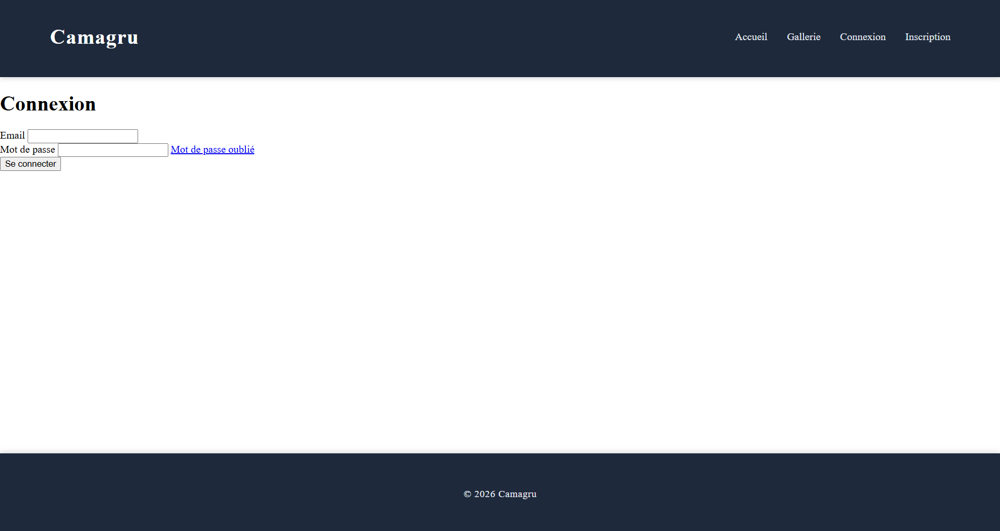
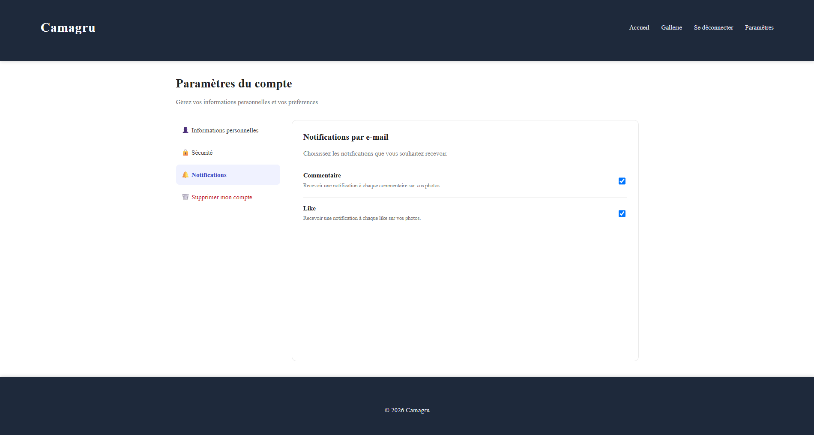
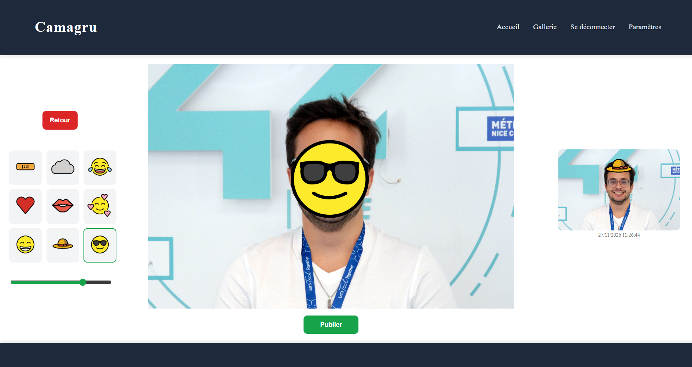
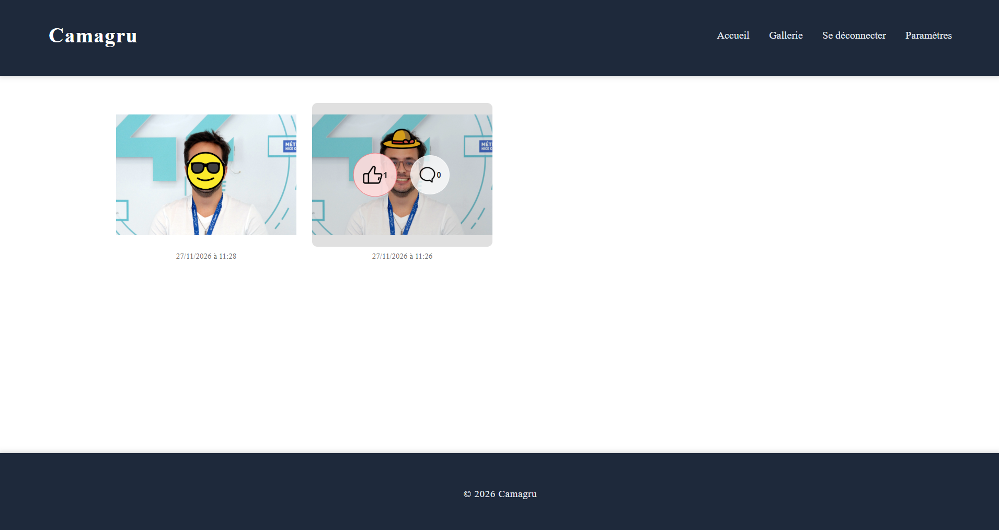

# Camagru

## 📖 Description

Camagru est un projet d'application web de montage photo.

L'application permet aux utilisateurs de prendre des photos via leur webcam ou d'importer une image, puis d'y superposer différents filtres ou éléments graphiques. Les créations sont publiées dans une galerie commune où elles peuvent être consultées, aimées et commentées par les autres utilisateurs.

---

## ✨ Fonctionnalités

### Utilisateurs

- Inscription avec validation par email
- Connexion / Déconnexion
- Réinitialisation du mot de passe
- Modification du profil
- Modification du mot de passe
- Gestion des préférences utilisateur

### Édition d'images

- Capture d'image via webcam
- Import d'image locale
- Sélection de filtres/stickers
- Fusion des images côté serveur
- Suppression de ses propres créations

### Galerie

- Affichage des créations de tous les utilisateurs
- Pagination
- Likes
- Commentaires
- Notification par email à chaque nouveaux likes/commentaires

### Sécurité

- Protection contre les injections SQL
- Protection contre le XSS
- Validation des formulaires
- Hashage sécurisé des mots de passe
- Gestion des permissions utilisateur


---

## 🏗️ Architecture

### Structure générale

```text
camagru/
├── Dockerfile
├── docker-compose.yml
├── docker/                         # Configuration Apache et msmtp
├── src/
|     ├── config/                   # Gestion des routes, de l'utilisateur, ...
|     ├── controller/               # Contrôleurs MVC
|     ├── database/                 # Base de donnée SQL
|     ├── public/                   # Images, Scripts, Assets, ...
|     └── view/                     # Vues MVC
└─ Makefile
```
### Architecture MVC

Le projet suit une architecture MVC (Model - View - Controller) afin de séparer les responsabilités et faciliter la maintenance du code.

- **Models** : gèrent les interactions avec la base de données et la logique métier.
- **Views** : responsables de l'affichage des pages HTML et de l'interface utilisateur.
- **Controllers** : reçoivent les requêtes utilisateur, exécutent les traitements nécessaires via les modèles puis sélectionnent la vue appropriée.

Cette organisation permet de conserver un code structuré, réutilisable et facilement évolutif.

---

## 🚀 Lancement du projet

### Construction et démarrage

Construire l'image Docker puis lancer les conteneurs :

```bash
make
```

L'application sera ensuite disponible à l'adresse :

```text
http://localhost:8080
```

### Commandes disponibles

| Commande | Description |
|-----------|------------|
| `make` | Construit l'image si nécessaire puis lance l'application |
| `make build` | Construit les images Docker |
| `make front` | Reconstruit et redémarre le service web |
| `make back` | Reconstruit et redémarre le service web |
| `make re` | Recrée entièrement les conteneurs |
| `make down` | Arrête les conteneurs |
| `make reset` | Réinitialise la base de données et relance l'application |

### Services disponibles

Une fois les conteneurs démarrés, plusieurs interfaces sont accessibles :

| Service | Adresse | Description |
|----------|----------|------------|
| Camagru | http://localhost:8080 | Application principale |
| phpMyAdmin | http://localhost:8081 | Administration de la base de données MariaDB |
| MailHog | http://localhost:8025 | Interface de consultation des emails envoyés par l'application |

## 📸 Aperçu


<table>
  <tr>
    <td align="center" width="50%">
      
      <br>
      <strong>Page de connexion</strong>
    </td>
    <td align="center" width="50%">
      
      <br>
      <strong>Paramètres</strong>
    </td>
  </tr>
  <tr>
      <td align="center" width="50%">
      
      <br>
      <strong>Création d'un montage</strong>
    </td>
    <td align="center" width="50%">
      
      <br>
      <strong>Galerie</strong>
    </td>
  </tr>
</table>

